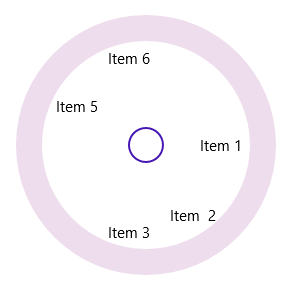

# Layout Types in UWP Radial Menu (SfRadialMenu)

There are two different layout types available for UWP Radial Menu. 

* Default
* Custom

Both the layout types divide the available space equally among all the children in the circular panel.

## Default

Number of segments in the panel is determined by children count in the level. Hence, the segment count differs in each hierarchical level. `SfRadialMenuItem` is arranged in the order in which it was added to the UWP Radial Menu.

## Custom

Number of segments in the panel is determined by VisibleSegmentsCount property. Hence, the segment count is the same in all hierarchical levels. `SfRadialMenuItem` is arranged based on the `SegmentIndex` property.

## VisibleSegmentsCount

VisibleSegmentsCount property is used to specify the number of segments available in circular panel. When the number of children is greater than `VisibleSegmentsCount`, the overflowing children are not arranged in the panel. When it is fewer, the remaining segments are left empty.




<navigation:SfRadialMenu LayoutType="Custom" VisibleSegmentsCount="7" />









SfRadialMenu radialMenu = new SfRadialMenu();
radialMenu.LayoutType = LayoutType.Custom;
radialMenu.VisibleSegmentsCount = 7; 
 




SfRadialMenu radialMenu = new SfRadialMenu()
radialMenu.LayoutType = LayoutType.Custom
radialMenu.VisibleSegmentsCount = 7
 




## SegmentIndex

SegmentIndex property is used to specify the index of the SfRadialMenuItem in circular panel. Based on the index, the `SfRadialMenuItem` objects are placed in the segments. When `SegmentIndex` is not specified for an item, or two or more items have the same `SegmentIndex`, the item is placed in the next available free segment. 



 <navigation:SfRadialMenu LayoutType="Custom" VisibleSegmentsCount="7" IsOpen="True">
 <navigation:SfRadialMenuItem Header="Item 2" SegmentIndex="1" />
 <navigation:SfRadialMenuItem Header="Item 5" SegmentIndex="4" /> 
 <navigation:SfRadialMenuItem Header="Item 1" SegmentIndex="0" />
 <navigation:SfRadialMenuItem Header="Item 6" SegmentIndex="5" />
 <navigation:SfRadialMenuItem Header="Item 3" SegmentIndex="2" />
 </navigation:SfRadialMenu> 








SfRadialMenu radialMenu = new SfRadialMenu();
radialMenu.LayoutType = LayoutType.Custom;
radialMenu.VisibleSegmentsCount = 7;          
radialMenu.Items.Add(new SfRadialMenuItem() { Header = "Item 2", SegmentIndex = 1 });
radialMenu.Items.Add(new SfRadialMenuItem() { Header = "Item 5", SegmentIndex = 4 });
radialMenu.Items.Add(new SfRadialMenuItem() { Header = "Item 1", SegmentIndex = 0 });
radialMenu.Items.Add(new SfRadialMenuItem() { Header = "Item 6", SegmentIndex = 5 });
radialMenu.Items.Add(new SfRadialMenuItem() { Header = "Item 3", SegmentIndex = 2 });





Dim radialMenu As New SfRadialMenu()
radialMenu.LayoutType = LayoutType.Custom
radialMenu.VisibleSegmentsCount = 7
radialMenu.Items.Add(New SfRadialMenuItem() With {
	.Header = "Item 2",
	.SegmentIndex = 1
})
radialMenu.Items.Add(New SfRadialMenuItem() With {
	.Header = "Item 5",
	.SegmentIndex = 4
})
radialMenu.Items.Add(New SfRadialMenuItem() With {
	.Header = "Item 1",
	.SegmentIndex = 0
})
radialMenu.Items.Add(New SfRadialMenuItem() With {
	.Header = "Item 6",
	.SegmentIndex = 5
})
radialMenu.Items.Add(New SfRadialMenuItem() With {
	.Header = "Item 3",
	.SegmentIndex = 2
})





