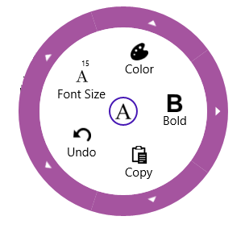

# About Syncfusion® UWP Radial Menu (SfRadialMenu) Control

The UWP Radial Menu displays a hierarchical menu in a circular layout optimized for touch devices. Typically used as a context menu, it can expose more menu items in the same space than traditional menus. 

## Key Features

* Items Source – Bind any business object collection to the control. 
* Commanding – Bind each item to a command that performs an action. 
* Color Palette – Easily form a radial color palette layout.
