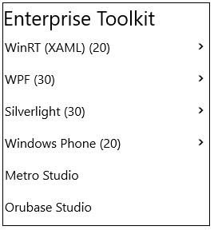

# Getting Started with UWP Tree Navigator

This section explains how to visualize hierarchal data in tree structure using `UWP Tree Navigator` control.

## Adding UWP Tree Navigator control

Create a Universal Windows Platform project in Visual Studio and refer to the following assemblies.

* Syncfusion.SfTreeNavigator.UWP
* Syncfusion.SfShared.UWP

1.Include the namespace for Syncfusion.SfTreeNavigator.UWP assembly in MainPage.xaml





<Page xmlns="http://schemas.microsoft.com/winfx/2006/xaml/presentation"

xmlns:x="http://schemas.microsoft.com/winfx/2006/xaml"

xmlns:navigation="using:Syncfusion.UI.Xaml.Controls.Navigation">





2.Now add the `UWP Tree Navigator` control with a required optimal name using the included namespace





<navigation:SfTreeNavigator x:Name="treeNavigator">





SfTreeNavigator treeNavigator = new SfTreeNavigator();





Dim treeNavigator As New SfTreeNavigator()





## Setting header for UWP Tree Navigator

Use `Header` property to set the header value “Enterprise Toolkit” for UWP Tree Navigator control as given below:





<navigation:SfTreeNavigator x:Name="treeNavigator" Header="Enterprise Toolkit"
                            Width="260" Height="280"/>








treeNavigator.Header = "Enterprise Toolkit";





treeNavigator.Header = "Enterprise Toolkit"





## Adding items to UWP Tree Navigator

Add the required number of items in multiple hierarchical levels as given below to the `UWP Tree Navigator` control:





<navigation:SfTreeNavigator Header="Enterprise Toolkit"
                            Width="260" Height="280"
							NavigationMode="Extended">
							
<navigation:SfTreeNavigatorItem>

<navigation:SfTreeNavigatorItem/>

</navigation:SfTreeNavigatorItem>

<navigation:SfTreeNavigatorItem>

<navigation:SfTreeNavigatorItem/>

</navigation:SfTreeNavigatorItem>

<navigation:SfTreeNavigatorItem>

<navigation:SfTreeNavigatorItem/>

</navigation:SfTreeNavigatorItem>

<navigation:SfTreeNavigatorItem>

<navigation:SfTreeNavigatorItem/>

</navigation:SfTreeNavigatorItem>

<navigation:SfTreeNavigatorItem/>

<navigation:SfTreeNavigatorItem/>

</navigation:SfTreeNavigator>









 SfTreeNavigator treeNavigator = new SfTreeNavigator();

 treeNavigator.Items.Add(new SfTreeNavigatorItem());

 treeNavigator.Items.Add(new SfTreeNavigatorItem());

 treeNavigator.Items.Add(new SfTreeNavigatorItem());

 treeNavigator.Items.Add(new SfTreeNavigatorItem());

 treeNavigator.Items.Add(new SfTreeNavigatorItem());





 Dim treeNavigator As New SfTreeNavigator()

 treeNavigator.Items.Add(New SfTreeNavigatorItem())

 treeNavigator.Items.Add(New SfTreeNavigatorItem())

 treeNavigator.Items.Add(New SfTreeNavigatorItem())

 treeNavigator.Items.Add(New SfTreeNavigatorItem())

 treeNavigator.Items.Add(New SfTreeNavigatorItem())





## Setting header for the UWP Tree Navigator Items

Set the header for all the items in the UWP Tree Navigator as given below:





<navigation:SfTreeNavigator Header="Enterprise Toolkit"
                            Width="260" Height="280"
							NavigationMode="Extended">
							
<navigation:SfTreeNavigatorItem Header="WinRT (XAML) (20)">

<navigation:SfTreeNavigatorItem Header="Controls"/>

</navigation:SfTreeNavigatorItem>

<navigation:SfTreeNavigatorItem Header="WPF (30)">

<navigation:SfTreeNavigatorItem Header="Controls"/>

</navigation:SfTreeNavigatorItem>

<navigation:SfTreeNavigatorItem Header="Silverlight (30)">

<navigation:SfTreeNavigatorItem Header="Controls"/>

</navigation:SfTreeNavigatorItem>

<navigation:SfTreeNavigatorItem Header="Windows Phone (20)">

<navigation:SfTreeNavigatorItem Header="Controls"/>

</navigation:SfTreeNavigatorItem>

<navigation:SfTreeNavigatorItem Header="Metro Studio"/>

<navigation:SfTreeNavigatorItem Header="Orubase Studio"/>

</navigation:SfTreeNavigator>









  SfTreeNavigator treeNavigator = new SfTreeNavigator(){Header="Enterprise Toolkit",Width=260 , Height=280,NavigationMode=NavigationMode.Extended};

  SfTreeNavigatorItem winrtItem = new SfTreeNavigatorItem() { Header = "WinRT (XAML) (20)" };
  winrtItem.Items.Add(new SfTreeNavigatorItem() { Header = "Controls" });

  SfTreeNavigatorItem wpfItem = new SfTreeNavigatorItem() { Header = "WPF (30)" };
  wpfItem.Items.Add(new SfTreeNavigatorItem() { Header = "Controls" });

  SfTreeNavigatorItem silverlightItem = new SfTreeNavigatorItem() { Header = "Silverlight (30)" };
  silverlightItem.Items.Add(new SfTreeNavigatorItem() { Header = "Controls" });

  SfTreeNavigatorItem wpItem = new SfTreeNavigatorItem() { Header = "Windows Phone (20)" };
  wpItem.Items.Add(new SfTreeNavigatorItem() { Header = "Controls" });

  treeNavigator.Items.Add(winrtItem);
  treeNavigator.Items.Add(wpfItem);
  treeNavigator.Items.Add(silverlightItem);
  treeNavigator.Items.Add(wpItem);
  treeNavigator.Items.Add(new SfTreeNavigatorItem() { Header = "Metro Studio" });
  treeNavigator.Items.Add(new SfTreeNavigatorItem() { Header = "Orubase Studio" });





Dim treeNavigator As New SfTreeNavigator() With {
	.Header="Enterprise Toolkit",
	.Width=260,
	.Height=280,
	.NavigationMode=NavigationMode.Extended
}

Dim winrtItem As New SfTreeNavigatorItem() With {.Header = "WinRT (XAML) (20)"}
winrtItem.Items.Add(New SfTreeNavigatorItem() With {.Header = "Controls"})

Dim wpfItem As New SfTreeNavigatorItem() With {.Header = "WPF (30)"}
wpfItem.Items.Add(New SfTreeNavigatorItem() With {.Header = "Controls"})

Dim silverlightItem As New SfTreeNavigatorItem() With {.Header = "Silverlight (30)"}
silverlightItem.Items.Add(New SfTreeNavigatorItem() With {.Header = "Controls"})

Dim wpItem As New SfTreeNavigatorItem() With {.Header = "Windows Phone (20)"}
wpItem.Items.Add(New SfTreeNavigatorItem() With {.Header = "Controls"})

treeNavigator.Items.Add(winrtItem)
treeNavigator.Items.Add(wpfItem)
treeNavigator.Items.Add(silverlightItem)
treeNavigator.Items.Add(wpItem)
treeNavigator.Items.Add(New SfTreeNavigatorItem() With {.Header = "Metro Studio"})
treeNavigator.Items.Add(New SfTreeNavigatorItem() With {.Header = "Orubase Studio"})





